# All BCE and Sequence Diagrams


---

# User Story 1: Create User Profile

## BCE Diagram

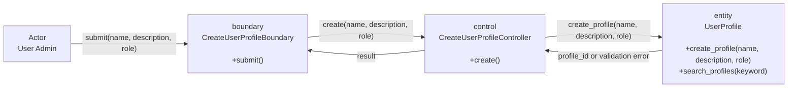

## Sequence Diagram

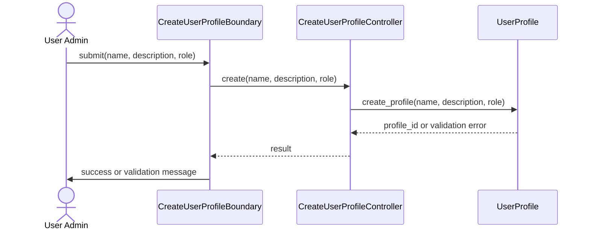

---

# User Story 2: View User Profile

## BCE Diagram

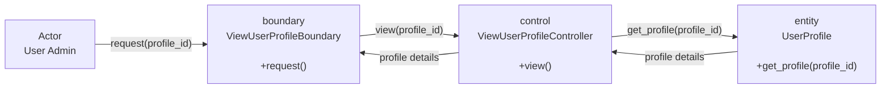

## Sequence Diagram

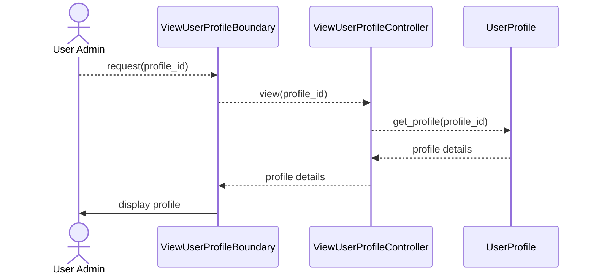

---

# User Story 3: Update User Profile

## BCE Diagram

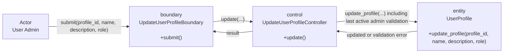

## Sequence Diagram

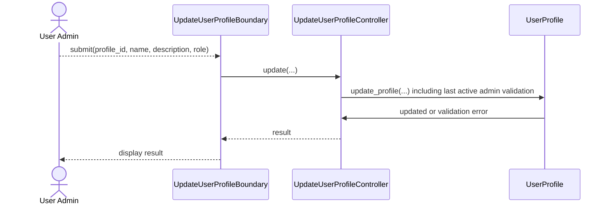

---

# User Story 4: Manage User Profile Status

## BCE Diagram

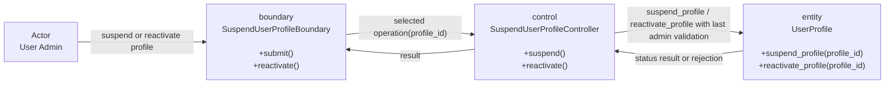

## Sequence Diagram

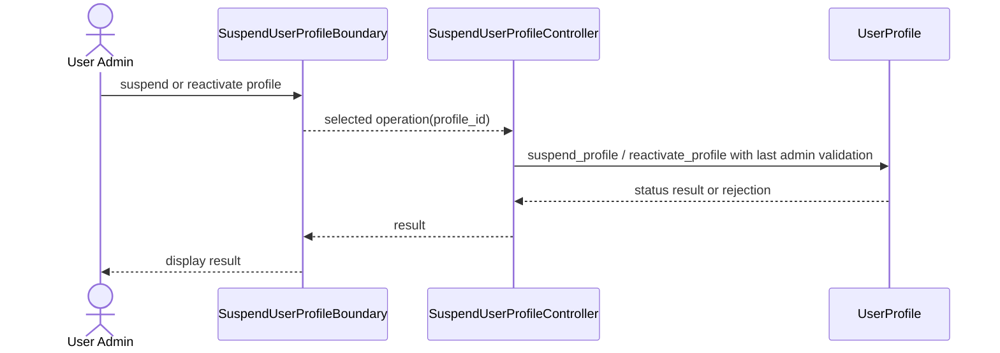

---

# User Story 5: Search User Profiles

## BCE Diagram

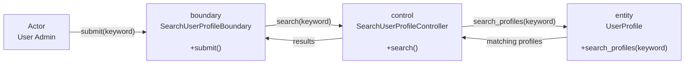

## Sequence Diagram

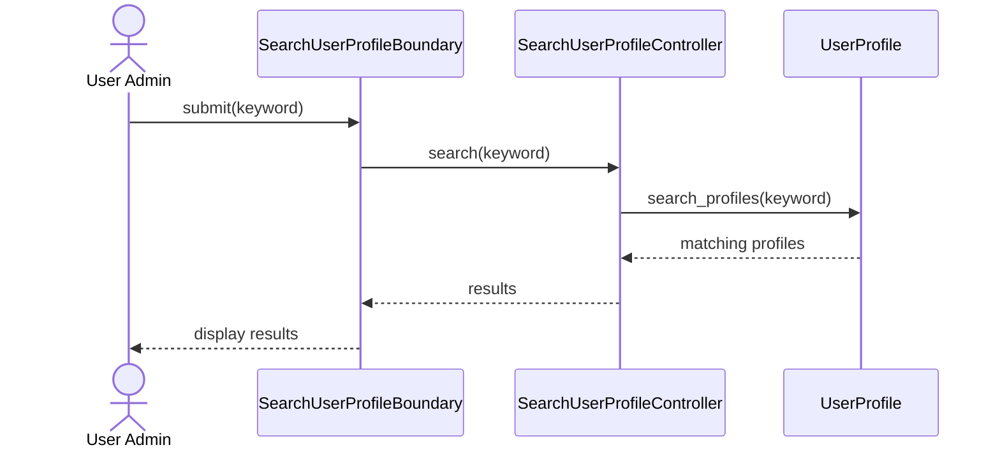

---

# User Story 6: Create User Account

## BCE Diagram

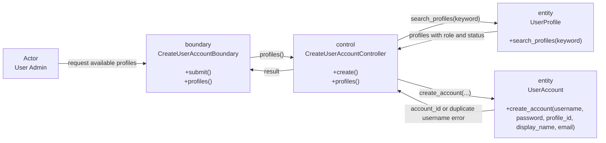

## Sequence Diagram

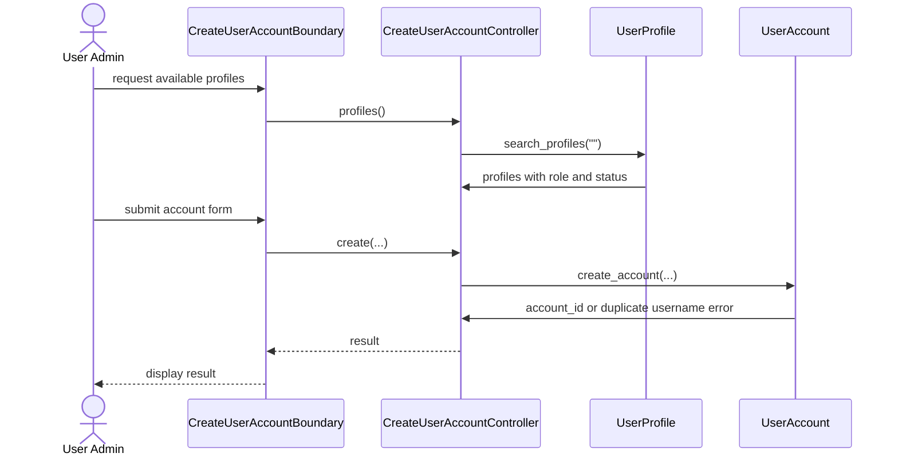

---

# User Story 7: View User Account

## BCE Diagram

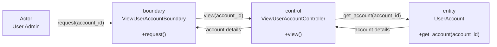

## Sequence Diagram

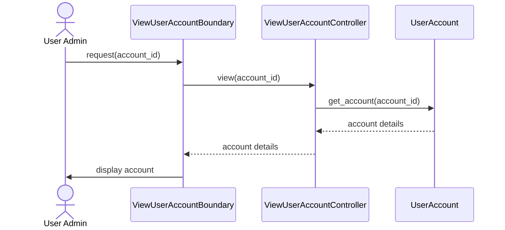

---

# User Story 8: Update User Account

## BCE Diagram

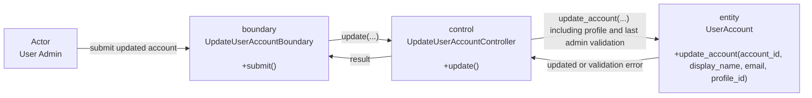

## Sequence Diagram

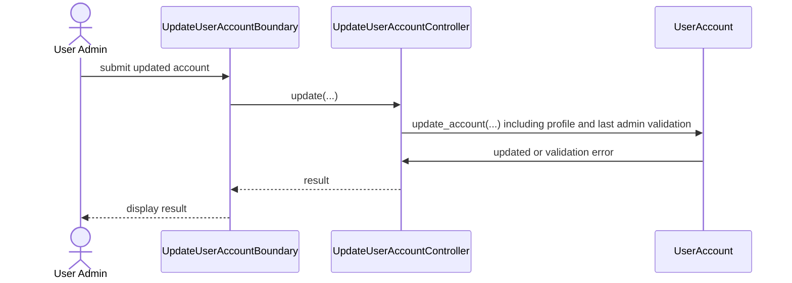

---

# User Story 9: Manage User Account Status

## BCE Diagram

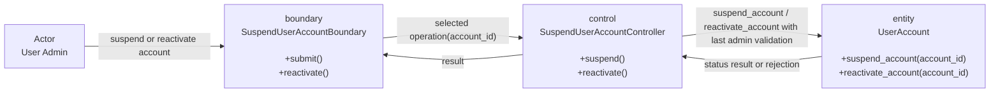

## Sequence Diagram

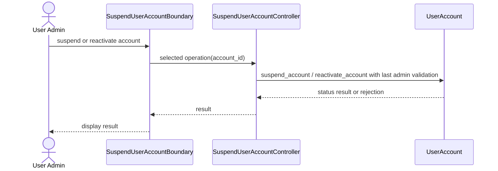

---

# User Story 10: Search User Accounts

## BCE Diagram

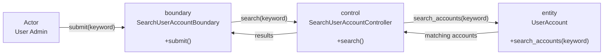

## Sequence Diagram

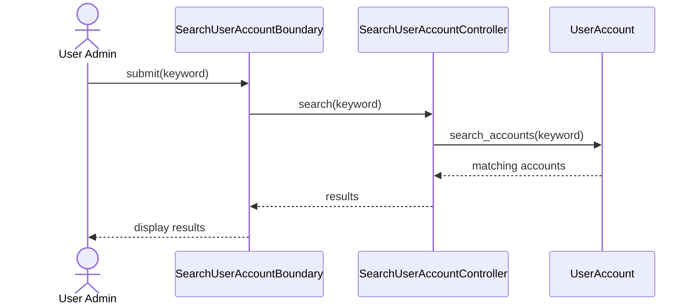

---

# User Story 11: User Admin Login

## BCE Diagram

```mermaid
flowchart LR
    N0["Actor<br/>User Admin"]
    N1["boundary<br/>LoginBoundary<br/><br/>+submit()"]
    N2["control<br/>AuthenticationController<br/><br/>+login()"]
    N3["entity<br/>UserAccount<br/><br/>+find_by_username(username)<br/>+verify_password(account, password)"]
    N4["entity<br/>UserProfile<br/><br/>+get_profile(profile_id)"]
    N5["control<br/>UserAdminLoginController<br/><br/>+complete_login(account, profile)"]
    N6["entity<br/>Session<br/><br/>+create_session(account_id, role)"]
    N0 -->|"submit username and password"| N1
    N1 -->|"login(username, password)"| N2
    N2 -->|"find_by_username(username)"| N3
    N3 -->|"account"| N2
    N2 -->|"get_profile(profile_id)"| N4
    N4 -->|"active profile with role"| N2
    N2 -->|"complete_login(account, profile)"| N5
    N5 -->|"create_session(account_id, role)"| N6
    N6 -->|"session_id"| N5
    N5 -->|"account and session_id"| N2
    N2 -->|"login result"| N1
```

## Sequence Diagram

```mermaid
sequenceDiagram
    actor P0 as User Admin
    participant P1 as LoginBoundary
    participant P2 as AuthenticationController
    participant P3 as UserAccount
    participant P4 as UserProfile
    participant P5 as UserAdminLoginController
    participant P6 as Session
    P0->>P1: submit username and password
    P1->>P2: login(username, password)
    P2->>P3: find_by_username(username)
    P3->>P2: account
    P2->>P3: verify_password(account, password)
    P3-->>P2: valid or invalid
    P2-->>P4: get_profile(profile_id)
    P4->>P2: active profile with role
    P2->>P5: complete_login(account, profile)
    P5->>P6: create_session(account_id, role)
    P6-->>P5: session_id
    P5-->>P2: account and session_id
    P2-->>P1: login result
    P1->>P0: redirect to dashboard or show error
```

---

# User Story 12: User Admin Logout

## BCE Diagram

```mermaid
flowchart LR
    N0["Actor<br/>User Admin"]
    N1["boundary<br/>UserAdminLogoutBoundary<br/><br/>+submit()"]
    N2["control<br/>UserAdminLogoutController<br/><br/>+logout()"]
    N3["entity<br/>Session<br/><br/>+invalidate_session(session_id)"]
    N0 -->|"submit(session_context)"| N1
    N1 -->|"logout(session_context)"| N2
    N2 -->|"invalidate_session(session_id)"| N3
    N3 -->|"invalidated"| N2
    N2 -->|"result"| N1
```

## Sequence Diagram

```mermaid
sequenceDiagram
    actor P0 as User Admin
    participant P1 as UserAdminLogoutBoundary
    participant P2 as UserAdminLogoutController
    participant P3 as Session
    P0->>P1: submit(session_context)
    P1->>P2: logout(session_context)
    P2-->>P3: invalidate_session(session_id)
    P3->>P2: invalidated
    P2-->>P1: result
    P1->>P0: return to login page
```

---

# User Story 13: Create Company Information

## BCE Diagram

```mermaid
flowchart LR
    N0["Actor<br/>Interior Designer"]
    N1["boundary<br/>CreateCompanyInformationBoundary<br/><br/>+submit()"]
    N2["control<br/>CreateCompanyInformationController<br/><br/>+create()"]
    N3["entity<br/>Company<br/><br/>+create_company(designer_id, data)"]
    N0 -->|"submit(session, form)"| N1
    N1 -->|"create(session, data)"| N2
    N2 -->|"create_company(designer_id, data)"| N3
    N3 -->|"result"| N2
    N2 -->|"result"| N1
```

## Sequence Diagram

```mermaid
sequenceDiagram
    actor P0 as Interior Designer
    participant P1 as CreateCompanyInformationBoundary
    participant P2 as CreateCompanyInformationController
    participant P3 as Company
    P0->>P1: submit(session, form)
    P1->>P2: create(session, data)
    P2->>P2: read designer_id from trusted session
    P2->>P3: create_company(designer_id, data)
    P3-->>P2: result
    P2-->>P1: result
    P1-->>P0: display result
```

---

# User Story 14: View Company Information

## BCE Diagram

```mermaid
flowchart LR
    N0["Actor<br/>Interior Designer"]
    N1["boundary<br/>ViewCompanyInformationBoundary<br/><br/>+request()"]
    N2["control<br/>ViewCompanyInformationController<br/><br/>+view()"]
    N3["entity<br/>Company<br/><br/>+get_company(designer_id)"]
    N0 -->|"request(session)"| N1
    N1 -->|"view(session)"| N2
    N2 -->|"get_company(designer_id)"| N3
    N3 -->|"company details"| N2
    N2 -->|"company details"| N1
```

## Sequence Diagram

```mermaid
sequenceDiagram
    actor P0 as Interior Designer
    participant P1 as ViewCompanyInformationBoundary
    participant P2 as ViewCompanyInformationController
    participant P3 as Company
    P0->>P1: request(session)
    P1->>P2: view(session)
    P2->>P2: read designer_id from trusted session
    P2->>P3: get_company(designer_id)
    P3-->>P2: company details
    P2-->>P1: company details
    P1->>P0: display company
```

---

# User Story 15: Update Company Information

## BCE Diagram

```mermaid
flowchart LR
    N0["Actor<br/>Interior Designer"]
    N1["boundary<br/>UpdateCompanyInformationBoundary<br/><br/>+submit()"]
    N2["control<br/>UpdateCompanyInformationController<br/><br/>+update()"]
    N3["entity<br/>Company<br/><br/>+update_company(designer_id, data)"]
    N0 -->|"submit(session, form)"| N1
    N1 -->|"update(session, data)"| N2
    N2 -->|"update_company(designer_id, data)"| N3
    N3 -->|"result"| N2
    N2 -->|"result"| N1
```

## Sequence Diagram

```mermaid
sequenceDiagram
    actor P0 as Interior Designer
    participant P1 as UpdateCompanyInformationBoundary
    participant P2 as UpdateCompanyInformationController
    participant P3 as Company
    P0->>P1: submit(session, form)
    P1->>P2: update(session, data)
    P2->>P2: read designer_id from trusted session
    P2->>P3: update_company(designer_id, data)
    P3-->>P2: result
    P2-->>P1: result
    P1-->>P0: display result
```

---

# User Story 16: Delete Company Information

## BCE Diagram

```mermaid
flowchart LR
    N0["Actor<br/>Interior Designer"]
    N1["boundary<br/>DeleteCompanyInformationBoundary<br/><br/>+submit()"]
    N2["control<br/>DeleteCompanyInformationController<br/><br/>+delete()"]
    N3["entity<br/>Company<br/><br/>+delete_company(designer_id)"]
    N0 -->|"submit(session)"| N1
    N1 -->|"delete(session)"| N2
    N2 -->|"delete_company(designer_id)"| N3
    N3 -->|"delete result"| N2
    N2 -->|"result"| N1
```

## Sequence Diagram

```mermaid
sequenceDiagram
    actor P0 as Interior Designer
    participant P1 as DeleteCompanyInformationBoundary
    participant P2 as DeleteCompanyInformationController
    participant P3 as Company
    P0->>P1: submit(session)
    P1->>P2: delete(session)
    P2->>P2: read designer_id from trusted session
    P2->>P3: delete_company(designer_id)
    P3-->>P2: delete result
    P2-->>P1: result
    P1-->>P0: display result
```

---

# User Story 17: Search Company Information

## BCE Diagram

```mermaid
flowchart LR
    N0["Actor<br/>Interior Designer"]
    N1["boundary<br/>SearchCompanyInformationBoundary<br/><br/>+submit()"]
    N2["control<br/>SearchCompanyInformationController<br/><br/>+search()"]
    N3["entity<br/>Company<br/><br/>+search_company(designer_id, keyword)"]
    N0 -->|"submit(session, keyword)"| N1
    N1 -->|"search(session, keyword)"| N2
    N2 -->|"search_company(designer_id, keyword)"| N3
    N3 -->|"matching company data"| N2
    N2 -->|"results"| N1
```

## Sequence Diagram

```mermaid
sequenceDiagram
    actor P0 as Interior Designer
    participant P1 as SearchCompanyInformationBoundary
    participant P2 as SearchCompanyInformationController
    participant P3 as Company
    P0->>P1: submit(session, keyword)
    P1->>P2: search(session, keyword)
    P2->>P2: read designer_id from trusted session
    P2->>P3: search_company(designer_id, keyword)
    P3-->>P2: matching company data
    P2-->>P1: results
    P1-->>P0: display results
```

---

# User Story 18: Interior Designer Login

## BCE Diagram

```mermaid
flowchart LR
    N0["Actor<br/>Interior Designer"]
    N1["boundary<br/>LoginBoundary<br/><br/>+submit()"]
    N2["control<br/>AuthenticationController<br/><br/>+login()"]
    N3["entity<br/>UserAccount<br/><br/>+find_by_username(username)<br/>+verify_password(account, password)"]
    N4["entity<br/>UserProfile<br/><br/>+get_profile(profile_id)"]
    N5["control<br/>InteriorDesignerLoginController<br/><br/>+complete_login(account, profile)"]
    N6["entity<br/>Session<br/><br/>+create_session(account_id, role)"]
    N0 -->|"submit username and password"| N1
    N1 -->|"login(username, password)"| N2
    N2 -->|"find_by_username(username)"| N3
    N3 -->|"account"| N2
    N2 -->|"get_profile(profile_id)"| N4
    N4 -->|"active profile with role"| N2
    N2 -->|"complete_login(account, profile)"| N5
    N5 -->|"create_session(account_id, role)"| N6
    N6 -->|"session_id"| N5
    N5 -->|"account and session_id"| N2
    N2 -->|"login result"| N1
```

## Sequence Diagram

```mermaid
sequenceDiagram
    actor P0 as Interior Designer
    participant P1 as LoginBoundary
    participant P2 as AuthenticationController
    participant P3 as UserAccount
    participant P4 as UserProfile
    participant P5 as InteriorDesignerLoginController
    participant P6 as Session
    P0->>P1: submit username and password
    P1->>P2: login(username, password)
    P2->>P3: find_by_username(username)
    P3->>P2: account
    P2->>P3: verify_password(account, password)
    P3-->>P2: valid or invalid
    P2-->>P4: get_profile(profile_id)
    P4->>P2: active profile with role
    P2->>P5: complete_login(account, profile)
    P5->>P6: create_session(account_id, role)
    P6-->>P5: session_id
    P5-->>P2: account and session_id
    P2-->>P1: login result
    P1->>P0: redirect to dashboard or show error
```

---

# User Story 19: Interior Designer Logout

## BCE Diagram

```mermaid
flowchart LR
    N0["Actor<br/>Interior Designer"]
    N1["boundary<br/>InteriorDesignerLogoutBoundary<br/><br/>+submit()"]
    N2["control<br/>InteriorDesignerLogoutController<br/><br/>+logout()"]
    N3["entity<br/>Session<br/><br/>+invalidate_session(session_id)"]
    N0 -->|"submit(session_context)"| N1
    N1 -->|"logout(session_context)"| N2
    N2 -->|"invalidate_session(session_id)"| N3
    N3 -->|"invalidated"| N2
    N2 -->|"result"| N1
```

## Sequence Diagram

```mermaid
sequenceDiagram
    actor P0 as Interior Designer
    participant P1 as InteriorDesignerLogoutBoundary
    participant P2 as InteriorDesignerLogoutController
    participant P3 as Session
    P0->>P1: submit(session_context)
    P1->>P2: logout(session_context)
    P2-->>P2: read session_id from trusted session
    P2-->>P3: invalidate_session(session_id)
    P3->>P2: invalidated
    P2-->>P1: result
    P1->>P0: clear local session and show login
```

---

# User Story 20: Create Current IDP

## BCE Diagram

```mermaid
flowchart LR
    N0["Actor<br/>Interior Designer"]
    N1["boundary<br/>CreateCurrentIDPBoundary<br/><br/>+submit()<br/>+categories()"]
    N2["control<br/>CreateCurrentIDPController<br/><br/>+create()<br/>+categories()"]
    N3["entity<br/>IDP<br/><br/>+create_project(designer_id, data, statusCurrent)"]
    N4["entity<br/>IDPCategory<br/><br/>+get_categories(active_only=True)"]
    N0 -->|"open project form"| N1
    N1 -->|"categories()"| N2
    N2 -->|"get_categories(active_only=True)"| N4
    N4 -->|"active categories"| N2
    N2 -->|"create_project(designer_id, data, statusCurrent)"| N3
    N3 -->|"project_id"| N2
    N2 -->|"result"| N1
```

## Sequence Diagram

```mermaid
sequenceDiagram
    actor P0 as Interior Designer
    participant P1 as CreateCurrentIDPBoundary
    participant P2 as CreateCurrentIDPController
    participant P3 as IDP
    participant P4 as IDPCategory
    P0->>P1: open project form
    P1->>P2: categories()
    P2->>P4: get_categories(active_only=True)
    P4->>P2: active categories
    P0->>P1: submit(session, form)
    P1->>P2: create(session, data)
    P2->>P2: read designer_id from trusted session
    P2->>P3: create_project(designer_id, data, "Current")
    P3-->>P2: project_id
    P2-->>P1: result
    P1->>P0: display success
```

---

# User Story 21: View Current IDPs

## BCE Diagram

```mermaid
flowchart LR
    N0["Actor<br/>Interior Designer"]
    N1["boundary<br/>ViewCurrentIDPBoundary<br/><br/>+request()"]
    N2["control<br/>ViewCurrentIDPController<br/><br/>+view()"]
    N3["entity<br/>IDP<br/><br/>+get_owned_projects(designer_id, statusCurrent)"]
    N0 -->|"request(session)"| N1
    N1 -->|"view(session)"| N2
    N2 -->|"get_owned_projects(designer_id, statusCurrent)"| N3
    N3 -->|"owned projects"| N2
    N2 -->|"results"| N1
```

## Sequence Diagram

```mermaid
sequenceDiagram
    actor P0 as Interior Designer
    participant P1 as ViewCurrentIDPBoundary
    participant P2 as ViewCurrentIDPController
    participant P3 as IDP
    P0->>P1: request(session)
    P1->>P2: view(session)
    P2->>P2: read designer_id from trusted session
    P2->>P3: get_owned_projects(designer_id, "Current")
    P3->>P2: owned projects
    P2-->>P1: results
    P1->>P0: display projects
```

---

# User Story 22: Update Current IDP

## BCE Diagram

```mermaid
flowchart LR
    N0["Actor<br/>Interior Designer"]
    N1["boundary<br/>UpdateCurrentIDPBoundary<br/><br/>+submit()"]
    N2["control<br/>UpdateCurrentIDPController<br/><br/>+update()"]
    N3["entity<br/>IDP<br/><br/>+update_owned_project(project_id, designer_id, data, statusCurrent)"]
    N0 -->|"submit(session, project_id, form)"| N1
    N1 -->|"update(session, project_id, data)"| N2
    N2 -->|"update_owned_project(project_id, designer_id, data, statusCurrent)"| N3
    N3 -->|"updated or rejected"| N2
    N2 -->|"result"| N1
```

## Sequence Diagram

```mermaid
sequenceDiagram
    actor P0 as Interior Designer
    participant P1 as UpdateCurrentIDPBoundary
    participant P2 as UpdateCurrentIDPController
    participant P3 as IDP
    P0-->>P1: submit(session, project_id, form)
    P1-->>P2: update(session, project_id, data)
    P2->>P2: read designer_id from trusted session
    P2-->>P3: update_owned_project(project_id, designer_id, data, "Current")
    P3->>P2: updated or rejected
    P2-->>P1: result
    P1-->>P0: display result
```

---

# User Story 23: Delete Current IDP

## BCE Diagram

```mermaid
flowchart LR
    N0["Actor<br/>Interior Designer"]
    N1["boundary<br/>DeleteCurrentIDPBoundary<br/><br/>+submit()"]
    N2["control<br/>DeleteCurrentIDPController<br/><br/>+delete()"]
    N3["entity<br/>IDP<br/><br/>+delete_owned_project(project_id, designer_id, statusCurrent)"]
    N0 -->|"confirm delete"| N1
    N1 -->|"delete(session, project_id)"| N2
    N2 -->|"delete_owned_project(project_id, designer_id, statusCurrent)"| N3
    N3 -->|"deleted or rejected"| N2
    N2 -->|"result"| N1
```

## Sequence Diagram

```mermaid
sequenceDiagram
    actor P0 as Interior Designer
    participant P1 as DeleteCurrentIDPBoundary
    participant P2 as DeleteCurrentIDPController
    participant P3 as IDP
    P0->>P1: confirm delete
    P1-->>P2: delete(session, project_id)
    P2->>P2: read designer_id from trusted session
    P2-->>P3: delete_owned_project(project_id, designer_id, "Current")
    P3->>P2: deleted or rejected
    P2-->>P1: result
    P1-->>P0: display result
```

---

# User Story 24: Search Current IDPs

## BCE Diagram

```mermaid
flowchart LR
    N0["Actor<br/>Interior Designer"]
    N1["boundary<br/>SearchCurrentIDPBoundary<br/><br/>+submit()"]
    N2["control<br/>SearchCurrentIDPController<br/><br/>+search()"]
    N3["entity<br/>IDP<br/><br/>+search_owned_projects(designer_id, statusCurrent, keyword)"]
    N0 -->|"submit(session, keyword)"| N1
    N1 -->|"search(session, keyword)"| N2
    N2 -->|"search_owned_projects(designer_id, statusCurrent, keyword)"| N3
    N3 -->|"matching projects"| N2
    N2 -->|"results"| N1
```

## Sequence Diagram

```mermaid
sequenceDiagram
    actor P0 as Interior Designer
    participant P1 as SearchCurrentIDPBoundary
    participant P2 as SearchCurrentIDPController
    participant P3 as IDP
    P0->>P1: submit(session, keyword)
    P1->>P2: search(session, keyword)
    P2->>P2: read designer_id from trusted session
    P2->>P3: search_owned_projects(designer_id, "Current", keyword)
    P3-->>P2: matching projects
    P2-->>P1: results
    P1-->>P0: display results
```

---

# User Story 25: Create Past IDP

## BCE Diagram

```mermaid
flowchart LR
    N0["Actor<br/>Interior Designer"]
    N1["boundary<br/>CreatePastIDPBoundary<br/><br/>+submit()<br/>+categories()"]
    N2["control<br/>CreatePastIDPController<br/><br/>+create()<br/>+categories()"]
    N3["entity<br/>IDP<br/><br/>+create_project(designer_id, data, statusPast)"]
    N4["entity<br/>IDPCategory<br/><br/>+get_categories(active_only=True)"]
    N0 -->|"open project form"| N1
    N1 -->|"categories()"| N2
    N2 -->|"get_categories(active_only=True)"| N4
    N4 -->|"active categories"| N2
    N2 -->|"create_project(designer_id, data, statusPast)"| N3
    N3 -->|"project_id"| N2
    N2 -->|"result"| N1
```

## Sequence Diagram

```mermaid
sequenceDiagram
    actor P0 as Interior Designer
    participant P1 as CreatePastIDPBoundary
    participant P2 as CreatePastIDPController
    participant P3 as IDP
    participant P4 as IDPCategory
    P0->>P1: open project form
    P1->>P2: categories()
    P2->>P4: get_categories(active_only=True)
    P4->>P2: active categories
    P0->>P1: submit(session, form)
    P1->>P2: create(session, data)
    P2->>P2: read designer_id from trusted session
    P2->>P3: create_project(designer_id, data, "Past")
    P3-->>P2: project_id
    P2-->>P1: result
    P1->>P0: display success
```

---

# User Story 26: View Past IDPs

## BCE Diagram

```mermaid
flowchart LR
    N0["Actor<br/>Interior Designer"]
    N1["boundary<br/>ViewPastIDPBoundary<br/><br/>+request()"]
    N2["control<br/>ViewPastIDPController<br/><br/>+view()"]
    N3["entity<br/>IDP<br/><br/>+get_owned_projects(designer_id, statusPast)"]
    N0 -->|"request(session)"| N1
    N1 -->|"view(session)"| N2
    N2 -->|"get_owned_projects(designer_id, statusPast)"| N3
    N3 -->|"owned projects"| N2
    N2 -->|"results"| N1
```

## Sequence Diagram

```mermaid
sequenceDiagram
    actor P0 as Interior Designer
    participant P1 as ViewPastIDPBoundary
    participant P2 as ViewPastIDPController
    participant P3 as IDP
    P0->>P1: request(session)
    P1->>P2: view(session)
    P2->>P2: read designer_id from trusted session
    P2->>P3: get_owned_projects(designer_id, "Past")
    P3->>P2: owned projects
    P2-->>P1: results
    P1->>P0: display projects
```

---

# User Story 27: Update Past IDP

## BCE Diagram

```mermaid
flowchart LR
    N0["Actor<br/>Interior Designer"]
    N1["boundary<br/>UpdatePastIDPBoundary<br/><br/>+submit()"]
    N2["control<br/>UpdatePastIDPController<br/><br/>+update()"]
    N3["entity<br/>IDP<br/><br/>+update_owned_project(project_id, designer_id, data, statusPast)"]
    N0 -->|"submit(session, project_id, form)"| N1
    N1 -->|"update(session, project_id, data)"| N2
    N2 -->|"update_owned_project(project_id, designer_id, data, statusPast)"| N3
    N3 -->|"updated or rejected"| N2
    N2 -->|"result"| N1
```

## Sequence Diagram

```mermaid
sequenceDiagram
    actor P0 as Interior Designer
    participant P1 as UpdatePastIDPBoundary
    participant P2 as UpdatePastIDPController
    participant P3 as IDP
    P0-->>P1: submit(session, project_id, form)
    P1-->>P2: update(session, project_id, data)
    P2->>P2: read designer_id from trusted session
    P2-->>P3: update_owned_project(project_id, designer_id, data, "Past")
    P3->>P2: updated or rejected
    P2-->>P1: result
    P1-->>P0: display result
```

---

# User Story 28: Delete Past IDP

## BCE Diagram

```mermaid
flowchart LR
    N0["Actor<br/>Interior Designer"]
    N1["boundary<br/>DeletePastIDPBoundary<br/><br/>+submit()"]
    N2["control<br/>DeletePastIDPController<br/><br/>+delete()"]
    N3["entity<br/>IDP<br/><br/>+delete_owned_project(project_id, designer_id, statusPast)"]
    N0 -->|"confirm delete"| N1
    N1 -->|"delete(session, project_id)"| N2
    N2 -->|"delete_owned_project(project_id, designer_id, statusPast)"| N3
    N3 -->|"deleted or rejected"| N2
    N2 -->|"result"| N1
```

## Sequence Diagram

```mermaid
sequenceDiagram
    actor P0 as Interior Designer
    participant P1 as DeletePastIDPBoundary
    participant P2 as DeletePastIDPController
    participant P3 as IDP
    P0->>P1: confirm delete
    P1-->>P2: delete(session, project_id)
    P2->>P2: read designer_id from trusted session
    P2-->>P3: delete_owned_project(project_id, designer_id, "Past")
    P3->>P2: deleted or rejected
    P2-->>P1: result
    P1-->>P0: display result
```

---

# User Story 29: Search Past IDPs

## BCE Diagram

```mermaid
flowchart LR
    N0["Actor<br/>Interior Designer"]
    N1["boundary<br/>SearchPastIDPBoundary<br/><br/>+submit()"]
    N2["control<br/>SearchPastIDPController<br/><br/>+search()"]
    N3["entity<br/>IDP<br/><br/>+search_owned_projects(designer_id, statusPast, keyword)"]
    N0 -->|"submit(session, keyword)"| N1
    N1 -->|"search(session, keyword)"| N2
    N2 -->|"search_owned_projects(designer_id, statusPast, keyword)"| N3
    N3 -->|"matching projects"| N2
    N2 -->|"results"| N1
```

## Sequence Diagram

```mermaid
sequenceDiagram
    actor P0 as Interior Designer
    participant P1 as SearchPastIDPBoundary
    participant P2 as SearchPastIDPController
    participant P3 as IDP
    P0->>P1: submit(session, keyword)
    P1->>P2: search(session, keyword)
    P2->>P2: read designer_id from trusted session
    P2->>P3: search_owned_projects(designer_id, "Past", keyword)
    P3-->>P2: matching projects
    P2-->>P1: results
    P1-->>P0: display results
```

---

# User Story 30: Search Available IDPs

## BCE Diagram

```mermaid
flowchart LR
    N0["Actor<br/>Customer"]
    N1["boundary<br/>SearchAvailableIDPBoundary<br/><br/>+submit()"]
    N2["control<br/>SearchAvailableIDPController<br/><br/>+search()"]
    N3["entity<br/>IDP<br/><br/>+search_available_projects(keyword)"]
    N0 -->|"submit(keyword)"| N1
    N1 -->|"search(keyword)"| N2
    N2 -->|"search_available_projects(keyword)"| N3
    N3 -->|"matching available projects"| N2
    N2 -->|"results"| N1
```

## Sequence Diagram

```mermaid
sequenceDiagram
    actor P0 as Customer
    participant P1 as SearchAvailableIDPBoundary
    participant P2 as SearchAvailableIDPController
    participant P3 as IDP
    P0->>P1: submit(keyword)
    P1->>P2: search(keyword)
    P2->>P3: search_available_projects(keyword)
    P3-->>P2: matching available projects
    P2-->>P1: results
    P1-->>P0: display results
```

---

# User Story 31: View Available IDP

## BCE Diagram

```mermaid
flowchart LR
    N0["Actor<br/>Customer"]
    N1["boundary<br/>ViewAvailableIDPBoundary<br/><br/>+request()"]
    N2["control<br/>ViewAvailableIDPController<br/><br/>+view()"]
    N3["entity<br/>IDP<br/><br/>+get_available_project(project_id)<br/>+record_view(project_id, customer_id)"]
    N0 -->|"request(session, project_id)"| N1
    N1 -->|"view(session, project_id)"| N2
    N2 -->|"get_available_project(project_id)"| N3
    N3 -->|"project details"| N2
    N2 -->|"project details"| N1
```

## Sequence Diagram

```mermaid
sequenceDiagram
    actor P0 as Customer
    participant P1 as ViewAvailableIDPBoundary
    participant P2 as ViewAvailableIDPController
    participant P3 as IDP
    P0-->>P1: request(session, project_id)
    P1-->>P2: view(session, project_id)
    P2-->>P3: get_available_project(project_id)
    P3-->>P2: project details
    P2->>P2: if role is Customer, read customer_id from session
    P2-->>P3: record_view(project_id, customer_id)
    P2-->>P1: project details
    P1->>P0: display project
```

---

# User Story 32: Save or Unsave IDP

## BCE Diagram

```mermaid
flowchart LR
    N0["Actor<br/>Customer"]
    N1["boundary<br/>SaveIDPBoundary<br/><br/>+submit()<br/>+unsave()<br/>+check_saved()"]
    N2["control<br/>SaveIDPController<br/><br/>+save()<br/>+unsave()<br/>+check_saved()"]
    N3["entity<br/>Favourite<br/><br/>+save_project(customer_id, project_id)<br/>+remove_project(customer_id, project_id)<br/>+is_saved(customer_id, project_id)"]
    N4["entity<br/>IDP<br/><br/>+get_available_project(project_id)"]
    N0 -->|"save, unsave, or check project"| N1
    N1 -->|"save / unsave / check_saved(session, project_id)"| N2
    N2 -->|"save_project / remove_project / is_saved"| N3
    N3 -->|"get_available_project(project_id) when saving"| N4
    N4 -->|"available or unavailable"| N3
    N3 -->|"saved state result"| N2
    N2 -->|"result"| N1
```

## Sequence Diagram

```mermaid
sequenceDiagram
    actor P0 as Customer
    participant P1 as SaveIDPBoundary
    participant P2 as SaveIDPController
    participant P3 as Favourite
    participant P4 as IDP
    P0->>P1: save, unsave, or check project
    P1-->>P2: save / unsave / check_saved(session, project_id)
    P2->>P2: read customer_id from trusted session
    P2->>P3: save_project / remove_project / is_saved
    P3-->>P4: get_available_project(project_id) when saving
    P4->>P3: available or unavailable
    P3-->>P2: saved state result
    P2-->>P1: result
    P1->>P0: display Save or Saved state
```

---

# User Story 33: Search Saved IDPs

## BCE Diagram

```mermaid
flowchart LR
    N0["Actor<br/>Customer"]
    N1["boundary<br/>SearchSavedIDPBoundary<br/><br/>+submit()"]
    N2["control<br/>SearchSavedIDPController<br/><br/>+search()"]
    N3["entity<br/>Favourite<br/><br/>+search_saved_projects(customer_id, keyword)"]
    N0 -->|"submit(session, keyword)"| N1
    N1 -->|"search(session, keyword)"| N2
    N2 -->|"search_saved_projects(customer_id, keyword)"| N3
    N3 -->|"matching saved projects"| N2
    N2 -->|"results"| N1
```

## Sequence Diagram

```mermaid
sequenceDiagram
    actor P0 as Customer
    participant P1 as SearchSavedIDPBoundary
    participant P2 as SearchSavedIDPController
    participant P3 as Favourite
    P0->>P1: submit(session, keyword)
    P1->>P2: search(session, keyword)
    P2->>P2: read customer_id from trusted session
    P2->>P3: search_saved_projects(customer_id, keyword)
    P3-->>P2: matching saved projects
    P2-->>P1: results
    P1-->>P0: display results
```

---

# User Story 34: View Saved IDPs

## BCE Diagram

```mermaid
flowchart LR
    N0["Actor<br/>Customer"]
    N1["boundary<br/>ViewSavedIDPBoundary<br/><br/>+request()"]
    N2["control<br/>ViewSavedIDPController<br/><br/>+view()"]
    N3["entity<br/>Favourite<br/><br/>+view_saved_projects(customer_id)"]
    N0 -->|"request(session)"| N1
    N1 -->|"view(session)"| N2
    N2 -->|"view_saved_projects(customer_id)"| N3
    N3 -->|"saved projects with current data"| N2
    N2 -->|"results"| N1
```

## Sequence Diagram

```mermaid
sequenceDiagram
    actor P0 as Customer
    participant P1 as ViewSavedIDPBoundary
    participant P2 as ViewSavedIDPController
    participant P3 as Favourite
    P0->>P1: request(session)
    P1->>P2: view(session)
    P2->>P2: read customer_id from trusted session
    P2->>P3: view_saved_projects(customer_id)
    P3->>P2: saved projects with current data
    P2-->>P1: results
    P1->>P0: display favourites
```

---

# User Story 35: Customer Login

## BCE Diagram

```mermaid
flowchart LR
    N0["Actor<br/>Customer"]
    N1["boundary<br/>LoginBoundary<br/><br/>+submit()"]
    N2["control<br/>AuthenticationController<br/><br/>+login()"]
    N3["entity<br/>UserAccount<br/><br/>+find_by_username(username)<br/>+verify_password(account, password)"]
    N4["entity<br/>UserProfile<br/><br/>+get_profile(profile_id)"]
    N5["control<br/>CustomerLoginController<br/><br/>+complete_login(account, profile)"]
    N6["entity<br/>Session<br/><br/>+create_session(account_id, role)"]
    N0 -->|"submit username and password"| N1
    N1 -->|"login(username, password)"| N2
    N2 -->|"find_by_username(username)"| N3
    N3 -->|"account"| N2
    N2 -->|"get_profile(profile_id)"| N4
    N4 -->|"active profile with role"| N2
    N2 -->|"complete_login(account, profile)"| N5
    N5 -->|"create_session(account_id, role)"| N6
    N6 -->|"session_id"| N5
    N5 -->|"account and session_id"| N2
    N2 -->|"login result"| N1
```

## Sequence Diagram

```mermaid
sequenceDiagram
    actor P0 as Customer
    participant P1 as LoginBoundary
    participant P2 as AuthenticationController
    participant P3 as UserAccount
    participant P4 as UserProfile
    participant P5 as CustomerLoginController
    participant P6 as Session
    P0->>P1: submit username and password
    P1->>P2: login(username, password)
    P2->>P3: find_by_username(username)
    P3->>P2: account
    P2->>P3: verify_password(account, password)
    P3-->>P2: valid or invalid
    P2-->>P4: get_profile(profile_id)
    P4->>P2: active profile with role
    P2->>P5: complete_login(account, profile)
    P5->>P6: create_session(account_id, role)
    P6-->>P5: session_id
    P5-->>P2: account and session_id
    P2-->>P1: login result
    P1->>P0: redirect to dashboard or show error
```

---

# User Story 36: Customer Logout

## BCE Diagram

```mermaid
flowchart LR
    N0["Actor<br/>Customer"]
    N1["boundary<br/>CustomerLogoutBoundary<br/><br/>+submit()"]
    N2["control<br/>CustomerLogoutController<br/><br/>+logout()"]
    N3["entity<br/>Session<br/><br/>+invalidate_session(session_id)"]
    N0 -->|"submit(session_context)"| N1
    N1 -->|"logout(session_context)"| N2
    N2 -->|"invalidate_session(session_id)"| N3
    N3 -->|"invalidated"| N2
    N2 -->|"result"| N1
```

## Sequence Diagram

```mermaid
sequenceDiagram
    actor P0 as Customer
    participant P1 as CustomerLogoutBoundary
    participant P2 as CustomerLogoutController
    participant P3 as Session
    P0->>P1: submit(session_context)
    P1->>P2: logout(session_context)
    P2-->>P2: read session_id from trusted session
    P2-->>P3: invalidate_session(session_id)
    P3->>P2: invalidated
    P2-->>P1: result
    P1->>P0: clear local session and show login
```

---

# User Story 37: View IDP View Count

## BCE Diagram

```mermaid
flowchart LR
    N0["Actor<br/>Interior Designer"]
    N1["boundary<br/>ViewIDPViewsBoundary<br/><br/>+request()"]
    N2["control<br/>ViewIDPViewsController<br/><br/>+view()"]
    N3["entity<br/>ViewMetric<br/><br/>+for_designer(designer_id)"]
    N4["entity<br/>IDP<br/><br/>+get_designer_projects_with_metrics(designer_id)"]
    N0 -->|"request(session)"| N1
    N1 -->|"view(session)"| N2
    N2 -->|"for_designer(designer_id)"| N3
    N3 -->|"get_designer_projects_with_metrics(designer_id)"| N4
    N4 -->|"projects with view totals"| N3
    N3 -->|"metrics"| N2
    N2 -->|"metrics"| N1
```

## Sequence Diagram

```mermaid
sequenceDiagram
    actor P0 as Interior Designer
    participant P1 as ViewIDPViewsBoundary
    participant P2 as ViewIDPViewsController
    participant P3 as ViewMetric
    participant P4 as IDP
    P0->>P1: request(session)
    P1->>P2: view(session)
    P2->>P2: read designer_id from trusted session
    P2->>P3: for_designer(designer_id)
    P3-->>P4: get_designer_projects_with_metrics(designer_id)
    P4->>P3: projects with view totals
    P3-->>P2: metrics
    P2-->>P1: metrics
    P1->>P0: display view counts
```

---

# User Story 38: View IDP Shortlist Count

## BCE Diagram

```mermaid
flowchart LR
    N0["Actor<br/>Interior Designer"]
    N1["boundary<br/>ViewIDPShortlistsBoundary<br/><br/>+request()"]
    N2["control<br/>ViewIDPShortlistsController<br/><br/>+view()"]
    N3["entity<br/>ShortlistMetric<br/><br/>+for_designer(designer_id)"]
    N4["entity<br/>IDP<br/><br/>+get_designer_projects_with_metrics(designer_id)"]
    N0 -->|"request(session)"| N1
    N1 -->|"view(session)"| N2
    N2 -->|"for_designer(designer_id)"| N3
    N3 -->|"get_designer_projects_with_metrics(designer_id)"| N4
    N4 -->|"projects with shortlist totals from favourites"| N3
    N3 -->|"metrics"| N2
    N2 -->|"metrics"| N1
```

## Sequence Diagram

```mermaid
sequenceDiagram
    actor P0 as Interior Designer
    participant P1 as ViewIDPShortlistsBoundary
    participant P2 as ViewIDPShortlistsController
    participant P3 as ShortlistMetric
    participant P4 as IDP
    P0->>P1: request(session)
    P1->>P2: view(session)
    P2->>P2: read designer_id from trusted session
    P2->>P3: for_designer(designer_id)
    P3-->>P4: get_designer_projects_with_metrics(designer_id)
    P4->>P3: projects with shortlist totals from favourites
    P3-->>P2: metrics
    P2-->>P1: metrics
    P1->>P0: display shortlist counts
```

---

# User Story 39: Create IDP Category

## BCE Diagram

```mermaid
flowchart LR
    N0["Actor<br/>Platform Manager"]
    N1["boundary<br/>CreateIDPCategoryBoundary<br/><br/>+submit()"]
    N2["control<br/>CreateIDPCategoryController<br/><br/>+create()"]
    N3["entity<br/>IDPCategory<br/><br/>+create_category(name, description)"]
    N0 -->|"submit(name, description)"| N1
    N1 -->|"create(name, description)"| N2
    N2 -->|"create_category(name, description)"| N3
    N3 -->|"category_id or duplicate error"| N2
    N2 -->|"result"| N1
```

## Sequence Diagram

```mermaid
sequenceDiagram
    actor P0 as Platform Manager
    participant P1 as CreateIDPCategoryBoundary
    participant P2 as CreateIDPCategoryController
    participant P3 as IDPCategory
    P0->>P1: submit(name, description)
    P1->>P2: create(name, description)
    P2->>P3: create_category(name, description)
    P3-->>P2: category_id or duplicate error
    P2-->>P1: result
    P1-->>P0: display result
```

---

# User Story 40: View IDP Category

## BCE Diagram

```mermaid
flowchart LR
    N0["Actor<br/>Platform Manager"]
    N1["boundary<br/>ViewIDPCategoryBoundary<br/><br/>+request()<br/>+request_all()"]
    N2["control<br/>ViewIDPCategoryController<br/><br/>+view()<br/>+view_all()"]
    N3["entity<br/>IDPCategory<br/><br/>+get_category(category_id)<br/>+get_categories()"]
    N0 -->|"request(category_id) or request_all()"| N1
    N1 -->|"view(category_id) or view_all()"| N2
    N2 -->|"get_category(category_id) or get_categories()"| N3
    N3 -->|"category details"| N2
    N2 -->|"result"| N1
```

## Sequence Diagram

```mermaid
sequenceDiagram
    actor P0 as Platform Manager
    participant P1 as ViewIDPCategoryBoundary
    participant P2 as ViewIDPCategoryController
    participant P3 as IDPCategory
    P0-->>P1: request(category_id) or request_all()
    P1-->>P2: view(category_id) or view_all()
    P2-->>P3: get_category(category_id) or get_categories()
    P3-->>P2: category details
    P2-->>P1: result
    P1->>P0: display category or list
```

---

# User Story 41: Update IDP Category

## BCE Diagram

```mermaid
flowchart LR
    N0["Actor<br/>Platform Manager"]
    N1["boundary<br/>UpdateIDPCategoryBoundary<br/><br/>+submit()"]
    N2["control<br/>UpdateIDPCategoryController<br/><br/>+update()"]
    N3["entity<br/>IDPCategory<br/><br/>+update_category(category_id, name, description)"]
    N0 -->|"submit(category_id, form)"| N1
    N1 -->|"update(category_id, name, description)"| N2
    N2 -->|"update_category(category_id, name, description)"| N3
    N3 -->|"update result"| N2
    N2 -->|"result"| N1
```

## Sequence Diagram

```mermaid
sequenceDiagram
    actor P0 as Platform Manager
    participant P1 as UpdateIDPCategoryBoundary
    participant P2 as UpdateIDPCategoryController
    participant P3 as IDPCategory
    P0-->>P1: submit(category_id, form)
    P1-->>P2: update(category_id, name, description)
    P2-->>P3: update_category(category_id, name, description)
    P3-->>P2: update result
    P2-->>P1: result
    P1-->>P0: display result
```

---

# User Story 42: Manage IDP Category Status

## BCE Diagram

```mermaid
flowchart LR
    N0["Actor<br/>Platform Manager"]
    N1["boundary<br/>SuspendIDPCategoryBoundary<br/><br/>+submit()<br/>+reactivate()<br/>+delete()"]
    N2["control<br/>SuspendIDPCategoryController<br/><br/>+suspend()<br/>+reactivate()<br/>+delete()"]
    N3["entity<br/>IDPCategory<br/><br/>+suspend_category(category_id)<br/>+reactivate_category(category_id)<br/>+delete_category(category_id)"]
    N0 -->|"suspend, reactivate, or delete category"| N1
    N1 -->|"selected operation(category_id)"| N2
    N2 -->|"suspend_category / reactivate_category / delete_category"| N3
    N3 -->|"result"| N2
    N2 -->|"result"| N1
```

## Sequence Diagram

```mermaid
sequenceDiagram
    actor P0 as Platform Manager
    participant P1 as SuspendIDPCategoryBoundary
    participant P2 as SuspendIDPCategoryController
    participant P3 as IDPCategory
    P0->>P1: suspend, reactivate, or delete category
    P1-->>P2: selected operation(category_id)
    P2->>P3: suspend_category / reactivate_category / delete_category
    P3->>P3: when deleting, reject if projects still use category
    P3-->>P2: result
    P2-->>P1: result
    P1-->>P0: display result
```

---

# User Story 43: Search IDP Categories

## BCE Diagram

```mermaid
flowchart LR
    N0["Actor<br/>Platform Manager"]
    N1["boundary<br/>SearchIDPCategoryBoundary<br/><br/>+submit()"]
    N2["control<br/>SearchIDPCategoryController<br/><br/>+search()"]
    N3["entity<br/>IDPCategory<br/><br/>+search_categories(keyword)"]
    N0 -->|"submit(keyword)"| N1
    N1 -->|"search(keyword)"| N2
    N2 -->|"search_categories(keyword)"| N3
    N3 -->|"matching categories"| N2
    N2 -->|"results"| N1
```

## Sequence Diagram

```mermaid
sequenceDiagram
    actor P0 as Platform Manager
    participant P1 as SearchIDPCategoryBoundary
    participant P2 as SearchIDPCategoryController
    participant P3 as IDPCategory
    P0->>P1: submit(keyword)
    P1->>P2: search(keyword)
    P2->>P3: search_categories(keyword)
    P3-->>P2: matching categories
    P2-->>P1: results
    P1-->>P0: display results
```

---

# User Story 44: Generate Daily Report

## BCE Diagram

```mermaid
flowchart LR
    N0["Actor<br/>Platform Manager"]
    N1["boundary<br/>GenerateDailyReportBoundary<br/><br/>+submit()"]
    N2["control<br/>GenerateDailyReportController<br/><br/>+generate()"]
    N3["entity<br/>DailyReport<br/><br/>+generate(date_value)"]
    N4["entity<br/>ActivityEvent<br/><br/>+report_between(start, end)"]
    N0 -->|"submit(date_value)"| N1
    N1 -->|"generate(date_value)"| N2
    N2 -->|"generate(date_value)"| N3
    N3 -->|"report_between(start, end)"| N4
    N4 -->|"activity totals"| N3
    N3 -->|"report summary"| N2
    N2 -->|"report"| N1
```

## Sequence Diagram

```mermaid
sequenceDiagram
    actor P0 as Platform Manager
    participant P1 as GenerateDailyReportBoundary
    participant P2 as GenerateDailyReportController
    participant P3 as DailyReport
    participant P4 as ActivityEvent
    P0->>P1: submit(date_value)
    P1->>P2: generate(date_value)
    P2->>P3: generate(date_value)
    P3-->>P4: report_between(start, end)
    P4->>P3: activity totals
    P3-->>P2: report summary
    P2-->>P1: report
    P1-->>P0: display report
```

---

# User Story 45: Generate Weekly Report

## BCE Diagram

```mermaid
flowchart LR
    N0["Actor<br/>Platform Manager"]
    N1["boundary<br/>GenerateWeeklyReportBoundary<br/><br/>+submit()"]
    N2["control<br/>GenerateWeeklyReportController<br/><br/>+generate()"]
    N3["entity<br/>WeeklyReport<br/><br/>+generate(date_value)"]
    N4["entity<br/>ActivityEvent<br/><br/>+report_between(start, end)"]
    N0 -->|"submit(date_value)"| N1
    N1 -->|"generate(date_value)"| N2
    N2 -->|"generate(date_value)"| N3
    N3 -->|"report_between(start, end)"| N4
    N4 -->|"activity totals"| N3
    N3 -->|"report summary"| N2
    N2 -->|"report"| N1
```

## Sequence Diagram

```mermaid
sequenceDiagram
    actor P0 as Platform Manager
    participant P1 as GenerateWeeklyReportBoundary
    participant P2 as GenerateWeeklyReportController
    participant P3 as WeeklyReport
    participant P4 as ActivityEvent
    P0->>P1: submit(date_value)
    P1->>P2: generate(date_value)
    P2->>P3: generate(date_value)
    P3-->>P4: report_between(start, end)
    P4->>P3: activity totals
    P3-->>P2: report summary
    P2-->>P1: report
    P1-->>P0: display report
```

---

# User Story 46: Generate Monthly Report

## BCE Diagram

```mermaid
flowchart LR
    N0["Actor<br/>Platform Manager"]
    N1["boundary<br/>GenerateMonthlyReportBoundary<br/><br/>+submit()"]
    N2["control<br/>GenerateMonthlyReportController<br/><br/>+generate()"]
    N3["entity<br/>MonthlyReport<br/><br/>+generate(date_value)"]
    N4["entity<br/>ActivityEvent<br/><br/>+report_between(start, end)"]
    N0 -->|"submit(date_value)"| N1
    N1 -->|"generate(date_value)"| N2
    N2 -->|"generate(date_value)"| N3
    N3 -->|"report_between(start, end)"| N4
    N4 -->|"activity totals"| N3
    N3 -->|"report summary"| N2
    N2 -->|"report"| N1
```

## Sequence Diagram

```mermaid
sequenceDiagram
    actor P0 as Platform Manager
    participant P1 as GenerateMonthlyReportBoundary
    participant P2 as GenerateMonthlyReportController
    participant P3 as MonthlyReport
    participant P4 as ActivityEvent
    P0->>P1: submit(date_value)
    P1->>P2: generate(date_value)
    P2->>P3: generate(date_value)
    P3-->>P4: report_between(start, end)
    P4->>P3: activity totals
    P3-->>P2: report summary
    P2-->>P1: report
    P1-->>P0: display report
```

---

# User Story 47: Platform Manager Login

## BCE Diagram

```mermaid
flowchart LR
    N0["Actor<br/>Platform Manager"]
    N1["boundary<br/>LoginBoundary<br/><br/>+submit()"]
    N2["control<br/>AuthenticationController<br/><br/>+login()"]
    N3["entity<br/>UserAccount<br/><br/>+find_by_username(username)<br/>+verify_password(account, password)"]
    N4["entity<br/>UserProfile<br/><br/>+get_profile(profile_id)"]
    N5["control<br/>PlatformManagerLoginController<br/><br/>+complete_login(account, profile)"]
    N6["entity<br/>Session<br/><br/>+create_session(account_id, role)"]
    N0 -->|"submit username and password"| N1
    N1 -->|"login(username, password)"| N2
    N2 -->|"find_by_username(username)"| N3
    N3 -->|"account"| N2
    N2 -->|"get_profile(profile_id)"| N4
    N4 -->|"active profile with role"| N2
    N2 -->|"complete_login(account, profile)"| N5
    N5 -->|"create_session(account_id, role)"| N6
    N6 -->|"session_id"| N5
    N5 -->|"account and session_id"| N2
    N2 -->|"login result"| N1
```

## Sequence Diagram

```mermaid
sequenceDiagram
    actor P0 as Platform Manager
    participant P1 as LoginBoundary
    participant P2 as AuthenticationController
    participant P3 as UserAccount
    participant P4 as UserProfile
    participant P5 as PlatformManagerLoginController
    participant P6 as Session
    P0->>P1: submit username and password
    P1->>P2: login(username, password)
    P2->>P3: find_by_username(username)
    P3->>P2: account
    P2->>P3: verify_password(account, password)
    P3-->>P2: valid or invalid
    P2-->>P4: get_profile(profile_id)
    P4->>P2: active profile with role
    P2->>P5: complete_login(account, profile)
    P5->>P6: create_session(account_id, role)
    P6-->>P5: session_id
    P5-->>P2: account and session_id
    P2-->>P1: login result
    P1->>P0: redirect to dashboard or show error
```

---

# User Story 48: Platform Manager Logout

## BCE Diagram

```mermaid
flowchart LR
    N0["Actor<br/>Platform Manager"]
    N1["boundary<br/>PlatformManagerLogoutBoundary<br/><br/>+submit()"]
    N2["control<br/>PlatformManagerLogoutController<br/><br/>+logout()"]
    N3["entity<br/>Session<br/><br/>+invalidate_session(session_id)"]
    N0 -->|"submit(session_context)"| N1
    N1 -->|"logout(session_context)"| N2
    N2 -->|"invalidate_session(session_id)"| N3
    N3 -->|"invalidated"| N2
    N2 -->|"result"| N1
```

## Sequence Diagram

```mermaid
sequenceDiagram
    actor P0 as Platform Manager
    participant P1 as PlatformManagerLogoutBoundary
    participant P2 as PlatformManagerLogoutController
    participant P3 as Session
    P0->>P1: submit(session_context)
    P1->>P2: logout(session_context)
    P2-->>P2: read session_id from trusted session
    P2-->>P3: invalidate_session(session_id)
    P3->>P2: invalidated
    P2-->>P1: result
    P1->>P0: clear local session and show login
```

---

# User Story 49: Delete User Profile

## BCE Diagram

```mermaid
flowchart LR
    N0["Actor<br/>User Admin"]
    N1["boundary<br/>DeleteUserProfileBoundary<br/><br/>+submit()"]
    N2["control<br/>DeleteUserProfileController<br/><br/>+delete()"]
    N3["entity<br/>UserProfile<br/><br/>+delete_profile(profile_id)"]
    N0 -->|"submit(profile_id)"| N1
    N1 -->|"delete(profile_id)"| N2
    N2 -->|"delete_profile(profile_id)"| N3
    N3 -->|"deleted or profile in use error"| N2
    N2 -->|"result"| N1
```

## Sequence Diagram

```mermaid
sequenceDiagram
    actor P0 as User Admin
    participant P1 as DeleteUserProfileBoundary
    participant P2 as DeleteUserProfileController
    participant P3 as UserProfile
    P0-->>P1: submit(profile_id)
    P1-->>P2: delete(profile_id)
    P2-->>P3: delete_profile(profile_id)
    P3->>P2: deleted or profile in use error
    P2-->>P1: result
    P1-->>P0: display result
```

---

# User Story 50: Browse IDPs as Authenticated Non Customer

## BCE Diagram

```mermaid
flowchart LR
    N0["Actor<br/>Authenticated Non Customer User"]
    N1["boundary<br/>BrowseIDPBoundary<br/><br/>+submit(session_context, keyword)<br/>+request(session_context, project_id)"]
    N2["control<br/>BrowseIDPController<br/><br/>+search(session_context, keyword)<br/>+view(session_context, project_id)"]
    N3["entity<br/>IDP<br/><br/>+search_available_projects(keyword)<br/>+get_available_project(project_id)"]
    N0 -->|"search keyword or request project"| N1
    N1 -->|"session context and request"| N2
    N2 -->|"validate non customer role"| N2
    N2 -->|"search available projects or get project"| N3
    N3 -->|"available projects or project details"| N2
    N2 -->|"read only result"| N1
```

## Sequence Diagram

```mermaid
sequenceDiagram
    actor P0 as Authenticated Non Customer User
    participant P1 as BrowseIDPBoundary
    participant P2 as BrowseIDPController
    participant P3 as IDP
    P0->>P1: search keyword or request project
    P1->>P2: session context and request
    P2->>P2: validate non customer role
    P2->>P3: search available projects or get project
    P3-->>P2: available projects or project details
    P2-->>P1: read only result
    P1-->>P0: display projects without favourite actions
```
