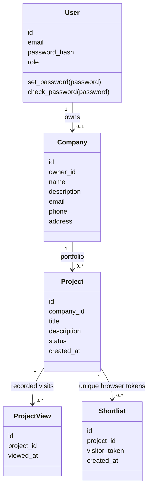
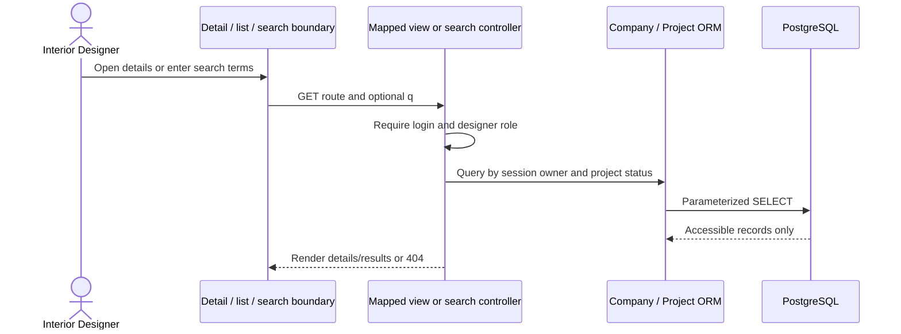

# BCE traceability and implementation diagrams

This document maps all **19 stories to 18 controller modules**. Authentication is the only shared story controller. The application implements controllers as Flask functions in modules, not Python controller classes. Names such as `CreateCompanyController` in a coursework diagram correspond to `create_company_controller.py:create` here.

No assignment UML files were supplied. The diagrams below describe the implementation; they do not claim approval against external class/sequence diagrams. Compare any later supplied UML with this mapping before submission.

## Complete story mapping

Boundary paths are relative to `app/templates/`, controllers to `app/controllers/`, and tests to `tests/`. Project wrappers in `projects/current/` and `projects/past/` extend shared `projects/` templates. Authenticated story routes use the session's `User`; owner-managed stories also use `Company` for authorization. Sequence keys refer to the diagrams below.

| Story | Controller module and handler | Boundary | Entity classes | Route(s) | Test case | Sequence |
| --- | --- | --- | --- | --- | --- | --- |
| UC01 Create company | `create_company_controller.py:create` | `company/form.html` | User, Company | GET/POST `/company/create` | `test_company.py::test_create_view_and_one_company_rule` | W |
| UC02 View company | `view_company_controller.py:index/detail` | `company/detail.html` | User, Company | GET `/company`, `/companies/<id>` | `test_company.py::test_create_view_and_one_company_rule` | R |
| UC03 Update company | `update_company_controller.py:update` | `company/form.html` | User, Company | GET/POST `/companies/<id>/edit` | `test_company.py::test_update_persists_valid_fields_and_rejects_invalid_fields` | W |
| UC04 Delete company | `delete_company_controller.py:delete` | `company/delete.html` | User, Company, Project | GET/POST `/companies/<id>/delete` | `test_company.py::test_delete_requires_confirmation_and_preserves_other_company`, `test_delete_blocks_projects_and_preserves_analytics` | D |
| UC05 Search company | `search_company_controller.py:search` | `company/search.html` | User, Company | GET `/company/search?q=...` | `test_company.py::test_search_is_literal_case_insensitive_and_owner_scoped` | R |
| UC06 Log in | `auth_controller.py:login` | `login.html` | User | GET/POST `/login` | `test_company.py::test_login_logout_flow` | L |
| UC07 Log out | `auth_controller.py:logout` | `base.html` logout form | User / session | POST `/logout` | `test_company.py::test_login_logout_flow`, `test_authentication_role_and_csrf_protection` | L |
| UC08 Create current IDP | `create_current_project_controller.py:create` | `projects/current/form.html` | User, Company, Project | GET/POST `/projects/current/create` | `test_current_projects.py::test_create_persists_text_and_ignores_company_and_status_input` | W |
| UC09 View current IDPs | `view_current_project_controller.py:index/detail` | `projects/current/list.html`, `detail.html` | User, Company, Project | GET `/projects/current`, `/projects/current/<id>` | `test_current_projects.py::test_view_list_detail_navigation_and_no_view_tracking` | R |
| UC10 Update current IDP | `update_current_project_controller.py:update` | `projects/current/form.html` | User, Company, Project | GET/POST `/projects/current/<id>/edit` | `test_current_projects.py::test_update_preserves_owner_status_and_created_date` | W |
| UC11 Delete current IDP | `delete_current_project_controller.py:delete` | `projects/current/delete.html` | User, Company, Project, ProjectView, Shortlist | GET/POST `/projects/current/<id>/delete` | `test_current_projects.py::test_delete_confirms_and_cascades_only_target_project_analytics` | D |
| UC12 Search current IDPs | `search_current_project_controller.py:search` | `projects/current/list.html` | User, Company, Project | GET `/projects/current/search?q=...` | `test_current_projects.py::test_search_is_literal_and_scoped_to_current_owned_projects` | R |
| UC13 Create past IDP | `create_past_project_controller.py:create` | `projects/past/form.html` | User, Company, Project | GET/POST `/projects/past/create` | `test_past_projects.py::test_create_persists_text_and_ignores_company_and_status_input` | W |
| UC14 View past IDPs | `view_past_project_controller.py:index/detail` | `projects/past/list.html`, `detail.html` | User, Company, Project | GET `/projects/past`, `/projects/past/<id>` | `test_past_projects.py::test_view_list_detail_navigation_and_no_view_tracking` | R |
| UC15 Update past IDP | `update_past_project_controller.py:update` | `projects/past/form.html` | User, Company, Project | GET/POST `/projects/past/<id>/edit` | `test_past_projects.py::test_update_preserves_owner_status_and_created_date` | W |
| UC16 Delete past IDP | `delete_past_project_controller.py:delete` | `projects/past/delete.html` | User, Company, Project, ProjectView, Shortlist | GET/POST `/projects/past/<id>/delete` | `test_past_projects.py::test_delete_confirms_and_cascades_only_target_project_analytics` | D |
| UC17 Search past IDPs | `search_past_project_controller.py:search` | `projects/past/list.html` | User, Company, Project | GET `/projects/past/search?q=...` | `test_past_projects.py::test_search_is_literal_and_scoped_to_past_owned_projects` | R |
| UC18 View IDP views | `view_project_views_controller.py:view` | `analytics/counts.html` | User, Company, Project, ProjectView | GET `/analytics/views`, `/projects/<id>/analytics/views` | `test_analytics.py::test_counts_include_both_statuses_zeroes_and_do_not_multiply`, `test_analytics_require_authentication_role_and_ownership` | A |
| UC19 View IDP shortlists | `view_project_shortlists_controller.py:view` | `analytics/counts.html` | User, Company, Project, Shortlist | GET `/analytics/shortlists`, `/projects/<id>/analytics/shortlists` | Same analytics count/access tests, `test_shortlists_deduplicate_per_project_and_browser` | A |

Tests for each group also cover invalid input, unauthenticated access, non-designer roles, CSRF, missing IDs, other owners and project status isolation. `test_readiness.py::test_exactly_18_story_controllers_are_wired_to_routes` checks the architectural constraint.

## Shared infrastructure

- `app/__init__.py`: factory, blueprint registration, protected dashboard, error boundaries and CLI registration.
- `company_support.py`: designer authorization, company ownership and reusable company forms.
- `project_support.py`: reusable text form and queries requiring both owner and project status.
- `analytics_support.py`: owner-scoped count queries for both statuses.
- `public_projects.py`: direct-link public detail and CSRF-protected anonymous shortlist endpoints. These generate records for UC18/19; they are not additional formal user stories or story-controller modules.
- `demo.py`: optional CLI sample data, outside the user-story controller count.
- `extensions.py`: database session, Flask-Login and global CSRF protection.

## Entity class diagram

The attributes are the actual SQLAlchemy model fields. Foreign keys cascade from deleted projects to their analytics. Company deletion is deliberately blocked while projects remain. Unique owner IDs implement one company per designer; unique project/token pairs deduplicate shortlists.



## L: Authentication sequences (UC06/07)

```mermaid
sequenceDiagram
    actor ID as Interior Designer
    participant B as Login / logout boundary
    participant C as AuthenticationController (auth_controller.py)
    participant U as User entity / ORM
    participant DB as PostgreSQL
    ID->>B: Enter email and password
    B->>C: POST /login + CSRF
    C->>U: Look up normalized email
    U->>DB: SELECT user
    DB-->>U: User and stored password hash
    C->>U: check_password(password)
    alt Valid credentials
        C-->>B: Set login session; redirect to dashboard
    else Invalid credentials
        C-->>B: Generic login error
    end
    ID->>B: Log out
    B->>C: POST /logout + CSRF
    C-->>B: Clear login session; redirect to login
```

## W: Create/update sequence

Use the exact create/update module in the mapping table. Company forms allow only the five company fields. Project forms allow only title/description. Project creation fixes status in its controller; editing cannot change status or company.

```mermaid
sequenceDiagram
    actor ID as Interior Designer
    participant B as Company / project form
    participant C as Mapped story controller
    participant E as Company / Project entity and ORM
    participant DB as PostgreSQL
    ID->>B: Open form
    B->>C: GET create or edit route
    C->>E: Resolve session owner and required status
    E->>DB: Owner-scoped SELECT
    C-->>B: Form or 404 / company prerequisite
    ID->>B: Submit allowed text fields
    B->>C: POST + CSRF
    C->>C: Authenticate, authorize, validate
    alt Invalid input
        C-->>B: 422 with field errors and retained input
    else Valid input
        C->>E: Assign allowed fields
        E->>DB: INSERT / UPDATE; commit
        C-->>B: Redirect to saved detail page
    end
```

## R: View/search sequence

For company search, the controller loads only the owned company and matches its field values in Python. Project search uses a parameterized ORM substring query with wildcard escaping and explicit status filtering.



## D: Confirmed deletion sequence

Company deletion locks the company row before counting dependencies and returns 409 if any projects remain. Project deletion uses existing database cascades after warning about analytics. GET never deletes a record.

```mermaid
sequenceDiagram
    actor ID as Interior Designer
    participant B as Delete confirmation boundary
    participant C as Mapped delete controller
    participant E as Company / Project ORM
    participant DB as PostgreSQL
    B->>C: GET delete route
    C->>E: Resolve owned object and required status
    C-->>B: Confirmation with dependency warning
    ID->>B: Check confirmation and submit
    B->>C: POST + CSRF + confirmation
    C->>E: Resolve owned object again
    opt Company deletion
        E->>DB: Lock company; count projects
    end
    alt Company has projects
        C-->>B: 409; preserve all data
    else Missing confirmation
        C-->>B: 422; preserve all data
    else Confirmed and allowed
        E->>DB: DELETE and commit
        Note over DB: Project deletion cascades its views/shortlists
        C-->>B: Redirect with success message
    end
```

## A: Engagement and private count sequence (UC18/19)

```mermaid
sequenceDiagram
    actor V as Public visitor
    participant P as Public project boundary
    participant I as Public engagement infrastructure
    participant E as Project / metric ORM
    participant DB as PostgreSQL
    actor ID as Interior Designer
    participant B as Analytics boundary
    participant C as Mapped analytics controller
    V->>P: Open shared project link
    P->>I: GET public detail
    I->>E: Resolve project
    opt Not owner and outside browser repeat window
        E->>DB: INSERT ProjectView; commit
    end
    I-->>P: Render public text and shortlist state
    V->>P: Shortlist project
    P->>I: POST + CSRF
    I->>E: Use signed-session browser token
    E->>DB: INSERT Shortlist; unique project/token constraint
    I-->>P: Redirect; repeated submissions keep one record
    ID->>B: View counts
    B->>C: GET private analytics route
    C->>E: Require designer; query owned projects and metric
    E->>DB: Owner-scoped SELECT with count subquery
    DB-->>C: Project/count rows, including zeros
    C-->>B: Render private counts
```

## Scope and remaining review

No registration story, image functionality, customer profiles, payments or messaging were added. PostgreSQL test isolation and demo provisioning are coursework infrastructure. A visual browser review and comparison against any later supplied UML are separate from the automated Flask-client verification; do not claim these were certified by the test suite.
