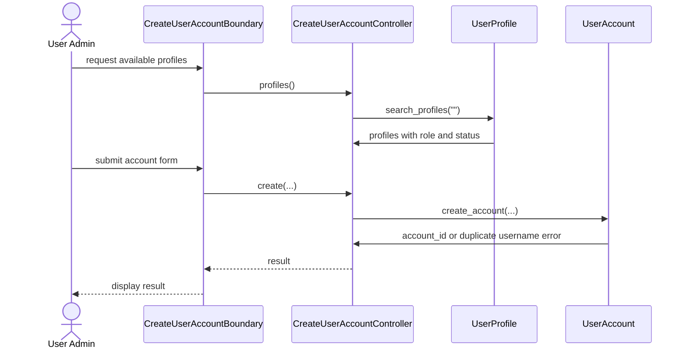

# User Story 6: Create User Account

## BCE Diagram

```mermaid
flowchart LR
    N0["Actor<br/>User Admin"]
    N1["&lt;&lt;boundary&gt;&gt;<br/>CreateUserAccountBoundary<br/><br/>+submit()<br/>+profiles()"]
    N2["&lt;&lt;control&gt;&gt;<br/>CreateUserAccountController<br/><br/>+create()<br/>+profiles()"]
    N3["&lt;&lt;entity&gt;&gt;<br/>UserProfile<br/><br/>+search_profiles("")"]
    N4["&lt;&lt;entity&gt;&gt;<br/>UserAccount<br/><br/>+create_account(username, password, profile_id, display_name, email)"]
    N0 -->|"request available profiles"| N1
    N1 -->|"profiles()"| N2
    N2 -->|"search_profiles(&quot;&quot;)"| N3
    N3 -->|"profiles with role and status"| N2
    N2 -->|"create_account(...)"| N4
    N4 -->|"account_id or duplicate username error"| N2
    N2 -->|"result"| N1
```

## Sequence Diagram


