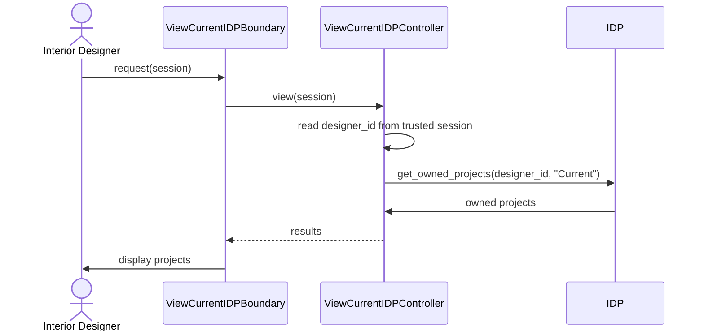

# User Story 21: View Current IDPs

## BCE Diagram

```mermaid
flowchart LR
    N0["Actor<br/>Interior Designer"]
    N1["&lt;&lt;boundary&gt;&gt;<br/>ViewCurrentIDPBoundary<br/><br/>+request()"]
    N2["&lt;&lt;control&gt;&gt;<br/>ViewCurrentIDPController<br/><br/>+view()"]
    N3["&lt;&lt;entity&gt;&gt;<br/>IDP<br/><br/>+get_owned_projects(designer_id, "Current")"]
    N0 -->|"request(session)"| N1
    N1 -->|"view(session)"| N2
    N2 -->|"get_owned_projects(designer_id, &quot;Current&quot;)"| N3
    N3 -->|"owned projects"| N2
    N2 -->|"results"| N1
```

## Sequence Diagram


