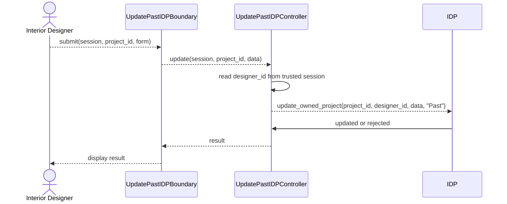

# User Story 27: Update Past IDP

## BCE Diagram

```mermaid
flowchart LR
    N0["Actor<br/>Interior Designer"]
    N1["&lt;&lt;boundary&gt;&gt;<br/>UpdatePastIDPBoundary<br/><br/>+submit()"]
    N2["&lt;&lt;control&gt;&gt;<br/>UpdatePastIDPController<br/><br/>+update()"]
    N3["&lt;&lt;entity&gt;&gt;<br/>IDP<br/><br/>+update_owned_project(project_id, designer_id, data, "Past")"]
    N0 -->|"submit(session, project_id, form)"| N1
    N1 -->|"update(session, project_id, data)"| N2
    N2 -->|"update_owned_project(project_id, designer_id, data, &quot;Past&quot;)"| N3
    N3 -->|"updated or rejected"| N2
    N2 -->|"result"| N1
```

## Sequence Diagram


