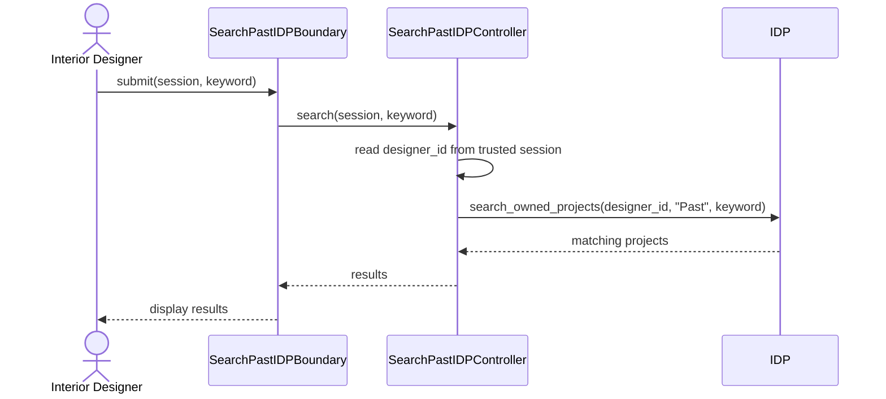

# User Story 29: Search Past IDPs

## BCE Diagram

```mermaid
flowchart LR
    N0["Actor<br/>Interior Designer"]
    N1["&lt;&lt;boundary&gt;&gt;<br/>SearchPastIDPBoundary<br/><br/>+submit()"]
    N2["&lt;&lt;control&gt;&gt;<br/>SearchPastIDPController<br/><br/>+search()"]
    N3["&lt;&lt;entity&gt;&gt;<br/>IDP<br/><br/>+search_owned_projects(designer_id, "Past", keyword)"]
    N0 -->|"submit(session, keyword)"| N1
    N1 -->|"search(session, keyword)"| N2
    N2 -->|"search_owned_projects(designer_id, &quot;Past&quot;, keyword)"| N3
    N3 -->|"matching projects"| N2
    N2 -->|"results"| N1
```

## Sequence Diagram


