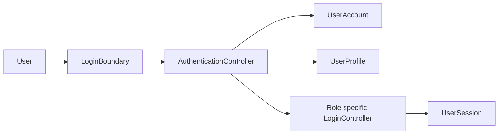
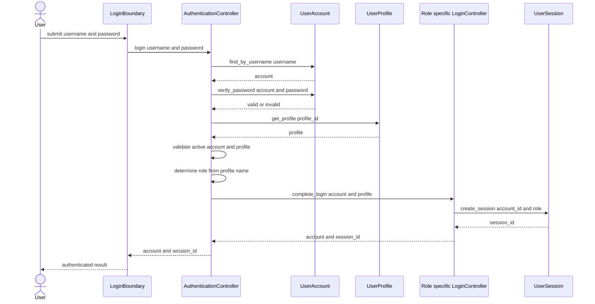

# Centralised login BCE and sequence diagrams

## BCE diagram

The role specific Controller is one of UserAdminLoginController, InteriorDesignerLoginController, CustomerLoginController or PlatformManagerLoginController. AuthenticationController chooses it only after UserProfile returns the stored profile name.

## Sequence diagram

## Failure flow

Invalid credentials, a suspended account, a suspended profile, or an unsupported profile name returns a failed result. No UserSession is created.
